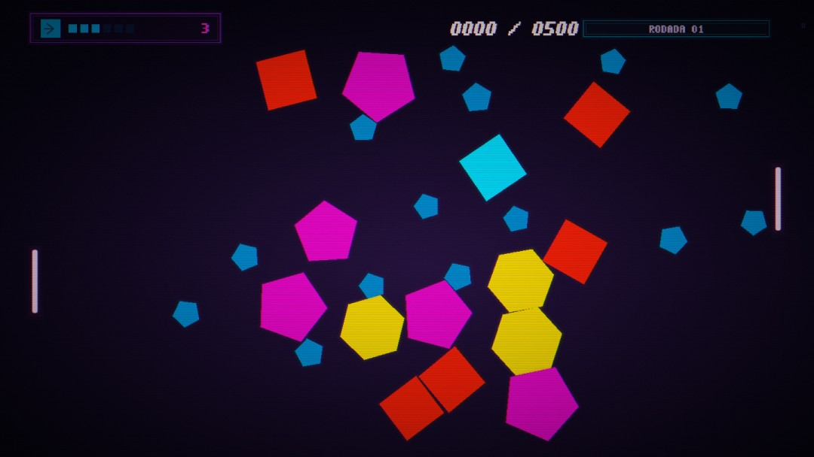

# Caderno de programação

Portfólio de jogos, sites e 48 projetos de estudo. O índice tem busca por assunto, filtro por nível e links diretos para cada demonstração.



## Rodar o portfólio completo

Use Node.js 24 ou superior. Na pasta deste README, execute:

```sh
node server.mjs
```

Abra **http://127.0.0.1:3000**. No Windows, também é possível usar **Abrir portfolio.cmd**. O servidor principal usa as bibliotecas incluídas no Node.js. Para executar os testes, use `npm test`.

## Explorar o código

| Pasta | Conteúdo |
| --- | --- |
| [dist/iniciante](dist/iniciante) | 15 ferramentas e jogos de navegador, da calculadora ao catálogo de produtos. |
| [dist/intermediario](dist/intermediario) e [server/intermediario](server/intermediario) | 16 projetos de aplicações web, incluindo comércio, reservas, chat e autenticação. |
| [dist/avancado](dist/avancado) e [server/avancado](server/avancado) | 17 laboratórios, com exemplos de filas, transações, WebSockets, eventos e distribuição de carga. |
| [infra/avancado](infra/avancado) | Instruções e configurações de infraestrutura para os laboratórios avançados. |
| [dist/arquivo](dist/arquivo) | Pacotes dos projetos anteriores. Crownbane tem [repositório próprio](https://github.com/Gghgdggggfdgbvvfg/Crownbane). Queens 258 aparece apenas como referência de uma demonstração privada. |

A hospedagem estática serve os arquivos de `dist`. Os estudos que precisam do servidor indicam essa condição na interface. As operações bancárias e de pagamentos usam valores fictícios. Os dados dos exercícios ficam no navegador ou na pasta local `.data/`.

A lista de referência tem 15 itens iniciantes, 16 intermediários e 17 avançados. O portfólio reúne também oito projetos anteriores identificados na área de trabalho.

